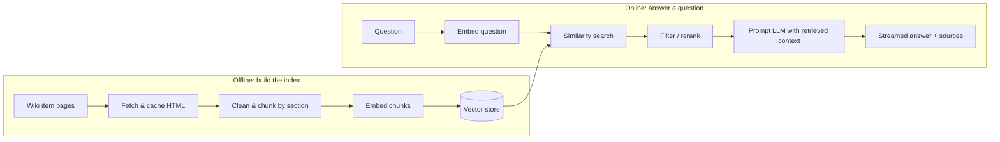

# Isaac_Agent

A question-answering assistant for *The Binding of Isaac: Rebirth*, built step by step from a plain **RAG (Retrieval-Augmented Generation)** chatbot into a **tool-using agent**.

Ask it things like *"What does Sacred Heart do?"*, *"What happens if I use Tammy's Head with Brimstone?"*, or *"How did Brimstone change in Repentance?"*. It answers from the community wiki, cites the pages it used, and says so when the wiki doesn't cover the question.

The project is a learning build: every stage of the pipeline (scraping, chunking, embedding, retrieval, reranking, generation, agents) is implemented by hand first, measured against a fixed evaluation set, and only then improved.

---

## How it works



1. **Collect:** fetch every collectible item page from the wiki, politely and once.
2. **Chunk:** split each page into self-contained sections (Effects, Synergies, Notes, ...) that keep version information such as *"(in Repentance)"*.
3. **Vectorize:** embed every chunk and store it in a vector database.
4. **Retrieve:** embed the question, find the most similar chunks, then filter and rerank them.
5. **Generate:** give the best chunks to the LLM, which answers only from that context, with citations, streamed token by token.
6. **Agent (planned):** turn retrieval into tools the LLM decides when and how often to call, so multi-item questions (e.g. synergies) can trigger several lookups.

---

## Status

| Phase | Description | Status |
|---|---|---|
| 0 | Environment setup, smoke test, evaluation set | ✅ Done |
| 1 | Fetch item list, download pages, clean & chunk | ✅ Done |
| 2 | Embed chunks into a vector store | ⏳ Next |
| 3 | Retrieval: top-k search, filtering, reranking | Planned |
| 4 | Generation: grounded prompting, citations, streaming chat UI | Planned |
| 5 | End-to-end evaluation & tuning | Planned |
| 6 | Agent: retrieval as tools, multi-step lookups, memory | Planned |

**Current corpus:** 719 collectible items (171 active, 548 passive) from 718 wiki pages, split into about 4,400 chunks (one summary chunk per item plus section chunks), averaging about 560 characters each.

---

## Data source & attribution

Content comes from **[The Binding of Isaac: Rebirth Wiki](https://bindingofisaacrebirth.wiki.gg/)** on wiki.gg, licensed under **[CC BY-SA 4.0](https://creativecommons.org/licenses/by-sa/4.0/)**. Answers produced by this project cite and link the wiki pages they draw from.

**Responsible fetching:**
- Only normal article pages (`/wiki/...`) are fetched, following the site's `robots.txt`; the MediaWiki API, which `robots.txt` disallows, is not used.
- 1 request per second, every page cached locally and never re-fetched.
- The run stops immediately on HTTP 403/429.
- Content is used for retrieval and citation, not for training models.
- The fetched data is **not** committed to this repository; it is rebuilt locally with the scripts below.

---

## Tech stack

| Purpose | Tool |
|---|---|
| Language | Python 3.12 (managed with [uv](https://docs.astral.sh/uv/)) |
| Fetching & parsing | `requests`, `beautifulsoup4`, `lxml` |
| LLM | DeepSeek (`deepseek-flash`) via the OpenAI-compatible API |
| Embeddings (planned) | `BAAI/bge-small-en-v1.5` via `sentence-transformers`, run locally |
| Vector store (planned) | Chroma |
| UI (planned) | Streamlit |

---

## Repository layout

```
Isaac_Agent/
  src/
    smoke_test.py       # checks wiki access + LLM API key
    fetch.py            # Items page -> data/items.json
    download_page.py    # item pages -> data/raw/*.html (cached, resumable)
    chunk.py            # cached pages -> data/chunks/chunks.jsonl
    check_coverage.py   # every eval page has chunks
  eval/
    questions.jsonl     # 25-question evaluation set
  data/                 # generated locally, gitignored
  DECISIONS.md          # design decisions and their reasoning
  .env.example          # required environment variables
```

---

## Setup

Requires Python 3.11+. With uv:

```bash
git clone <this repo>
cd Isaac_Agent
uv python install 3.12
uv venv --python 3.12
source .venv/bin/activate          # Windows: .venv\Scripts\activate
uv pip install -r requirements.txt
cp .env.example .env               # then add your API key
```

`.env` needs:
```
DEEPSEEK_API_KEY=your-key-here
```

Check that everything works:
```bash
python src/smoke_test.py
```

### Build the corpus

Run from the repository root, in order:

```bash
python src/fetch.py               # item list (1 request)
python src/download_page.py       # item pages (~15 min at 1 req/s; safe to stop and resume)
python src/chunk.py               # chunks
python src/check_coverage.py      # sanity check against the eval set
```

`download_page.py --limit 5` is useful for a quick test, and `--force` re-downloads pages after the wiki updates. `chunk.py --only "Brimstone"` prints one page's chunks for debugging.

---

## Evaluation

Every design choice is measured against a fixed set of 25 questions in `eval/questions.jsonl`, written and verified against the wiki **before** any pipeline code:

| Type | Count | Tests |
|---|---|---|
| Fact | 10 | Single-item lookups |
| Synergy | 5 | Interactions between two items |
| Paraphrase | 4 | Describing an item without naming it (semantic search) |
| Version | 3 | Differences between DLC versions |
| Unanswerable | 3 | Refusing instead of hallucinating |

Scoring:
- **Retrieval:** did the retrieved chunks include the page(s) that contain the answer?
- **Answer:** 2 correct, 1 partial, 0 wrong, −1 hallucinated.

Results will be added here as phases are completed.

---

## Design decisions

Reasoning behind the choices in this project (corpus selection, fetching rules, item identity, chunking strategy, model choices) is logged in **[DECISIONS.md](DECISIONS.md)**.
