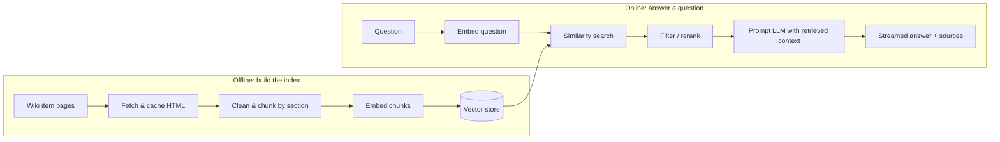

# Isaac_Agent

A question-answering assistant for *The Binding of Isaac: Rebirth*, built step by step from a plain **RAG (Retrieval-Augmented Generation)** chatbot into a **tool-using agent**.

Ask it things like *"What does Sacred Heart do?"*, *"What happens if I use Tammy's Head with Brimstone?"*, or *"How did Brimstone change in Repentance?"*. It answers from the community wiki, cites the pages it used, and says so when the wiki doesn't cover the question.

The project is a learning build: every stage of the pipeline (scraping, chunking, embedding, retrieval, reranking, generation, agents) is implemented by hand first, measured against a fixed evaluation set, and only then improved.

---

## How it works



1. **Collect:** fetch every collectible item page from the wiki, politely and once.
2. **Chunk:** split each page into self-contained sections (Effects, Synergies, Notes, ...) that keep version information such as *"(in Repentance)"*, plus one summary chunk per item (type, availability, quality, recharge, item pool, tags, description).
3. **Vectorize:** embed every chunk with a local embedding model and store it in a vector database.
4. **Retrieve:** embed the question, find the most similar chunks, then filter and rerank them.
5. **Generate:** give the best chunks to the LLM, which answers only from that context, with citations, streamed token by token.
6. **Agent (planned):** turn retrieval into tools the LLM decides when and how often to call, so multi-item questions (e.g. synergies) can trigger several lookups.

---

## Status

| Phase | Description | Status |
|---|---|---|
| 0 | Environment setup, smoke test, evaluation set | ✅ Done |
| 1 | Fetch item list, download pages, clean & chunk | ✅ Done |
| 2 | Embed chunks into a vector store; search; retrieval baseline | ✅ Done |
| 3 | Retrieval improvements: reranking, "I don't know" threshold | ⏳ Next |
| 4 | Generation: grounded prompting, citations, streaming chat UI | Planned |
| 5 | End-to-end evaluation & tuning | Planned |
| 6 | Agent: retrieval as tools, multi-step lookups, memory | Planned |

**Current corpus:** 719 collectible items (171 active, 548 passive) from 718 wiki pages, split into about 4,400 chunks (one summary chunk per item plus section chunks, each capped at ~1,500 characters), embedded into a Chroma collection.

---

## Retrieval results (Phase 2 baseline)

Measured on the 22 answerable questions of the evaluation set, plain vector search (no reranking), `k = 10`:

| Metric | Score |
|---|---|
| Page hit@5 / hit@10 | 95% / 100% |
| **Evidence@3** | **68%** |
| **Evidence@5** | **82%** |
| **Evidence@10** | **95%** |

- **Page hit@k:** the expected wiki page appears among the top k results.
- **Evidence@k:** a chunk containing the actual answer appears among the top k. This is stricter: a page can match through an unrelated section (e.g. Trivia) that doesn't answer the question.

The gap between evidence@5 and evidence@10 means some answers are retrieved but ranked too low to be passed to the LLM. Raising evidence@5 toward the evidence@10 ceiling is the goal of Phase 3 (reranking).

Off-topic questions score a lower similarity than real ones, but the margin on the current set is very small, so "I don't know" handling will combine a loose distance cutoff with a grounded prompt rather than rely on a threshold alone.

---

## Data source & attribution

Content comes from **[The Binding of Isaac: Rebirth Wiki](https://bindingofisaacrebirth.wiki.gg/)** on wiki.gg, licensed under **[CC BY-SA 4.0](https://creativecommons.org/licenses/by-sa/4.0/)**. Answers produced by this project cite and link the wiki pages they draw from.

**Responsible fetching:**
- Only normal article pages (`/wiki/...`) are fetched, following the site's `robots.txt`; the MediaWiki API, which `robots.txt` disallows, is not used.
- 1 request per second, every page cached locally and never re-fetched.
- The run stops immediately on HTTP 403/429.
- Content is used for retrieval and citation, not for training models.
- The fetched data is **not** committed to this repository; it is rebuilt locally with the scripts below.

---

## Tech stack

| Purpose | Tool |
|---|---|
| Language | Python 3.12 (managed with [uv](https://docs.astral.sh/uv/)) |
| Fetching & parsing | `requests`, `beautifulsoup4`, `lxml` |
| Embeddings | `BAAI/bge-small-en-v1.5` via `sentence-transformers`, run locally on CPU |
| Vector store | Chroma (persistent, cosine distance) |
| LLM | DeepSeek (`deepseek-flash`) via the OpenAI-compatible API |
| UI (planned) | Streamlit |

---

## Repository layout

```
Isaac_Agent/
  src/
    config.py           # shared settings: model, paths, collection name
    smoke_test.py       # checks wiki access + LLM API key
    fetch.py            # Items page -> data/items.json
    download_page.py    # item pages -> data/raw/*.html (cached, resumable)
    chunk.py            # cached pages -> data/chunks/chunks.jsonl
    check_coverage.py   # every eval page has chunks
    index.py            # chunks -> embeddings -> Chroma (data/chroma)
    search.py           # retrieve(question, k) + command-line search
    eval_retrieval.py   # retrieval metrics on the eval set
    embed_playground.py # exploration script for embeddings (not part of the pipeline)
  eval/
    questions.jsonl     # 25-question evaluation set
    results/            # saved evaluation runs (committed)
  data/                 # generated locally, gitignored
  DECISIONS.md          # design decisions and their reasoning
  .env.example          # required environment variables
```

---

## Setup

Requires Python 3.11+. With uv:

```bash
git clone <this repo>
cd Isaac_Agent
uv python install 3.12
uv venv --python 3.12
source .venv/bin/activate          # Windows: .venv\Scripts\activate

# CPU-only PyTorch first (much smaller than the default GPU build), then the rest
uv pip install torch --index-url https://download.pytorch.org/whl/cpu
uv pip install -r requirements.txt

cp .env.example .env               # then add your API key
```

`.env` needs:
```
DEEPSEEK_API_KEY=your-key-here
```

Check that everything works:
```bash
python src/smoke_test.py
```

**Embedding model download:** the scripts run Hugging Face in offline mode (`HF_HUB_OFFLINE=1`, set in `config.py`) so the model loads from the local cache without network checks. On a fresh machine the model (~130 MB) isn't cached yet; download it once by running:
```bash
HF_HUB_OFFLINE=0 python src/index.py
```
Later runs work offline.

### Build the corpus and index

Run from the repository root, in order:

```bash
python src/fetch.py               # item list (1 request)
python src/download_page.py       # item pages (~15 min at 1 req/s; safe to stop and resume)
python src/chunk.py               # chunks
python src/check_coverage.py      # sanity check against the eval set
python src/index.py               # embed + store in Chroma (~4 min on CPU)
```

Useful options:
- `download_page.py --limit 5` for a quick test; `--force` to re-download after the wiki updates
- `chunk.py --only "Brimstone"` prints one page's chunks for debugging

Whenever the chunks change, re-run `index.py`; it rebuilds the collection from scratch.

### Search and evaluate

```bash
python src/search.py "What item gives me a blood laser?" --k 5
python src/search.py "Tammy's Head with Brimstone" --k 5 --show-text
python src/eval_retrieval.py --label my_run      # saves eval/results/retrieval_my_run.json
```

---

## Evaluation

Every design choice is measured against a fixed set of 25 questions in `eval/questions.jsonl`, written and verified against the wiki **before** any pipeline code:

| Type | Count | Tests |
|---|---|---|
| Fact | 10 | Single-item lookups |
| Synergy | 5 | Interactions between two items |
| Paraphrase | 4 | Describing an item without naming it (semantic search) |
| Version | 3 | Differences between DLC versions |
| Unanswerable | 3 | Refusing instead of hallucinating |

Each answerable question lists the page(s) that contain its answer and a short **evidence** phrase from the answer text.

Scoring:
- **Retrieval:** page hit@k and evidence@k (see results above).
- **Answer (Phase 4+):** 2 correct, 1 partial, 0 wrong, −1 hallucinated.

---

## Design decisions

Reasoning behind the choices in this project (corpus selection, fetching rules, item identity, chunking strategy, embedding and vector store setup, evaluation metrics) is logged in **[DECISIONS.md](DECISIONS.md)**.

---

## License

Code: **MIT**.
Wiki content retrieved by the scripts: **CC BY-SA 4.0**, owned by its contributors and not included in this repository.

*The Binding of Isaac* is © Edmund McMillen and Nicalis. This is an unofficial fan project.